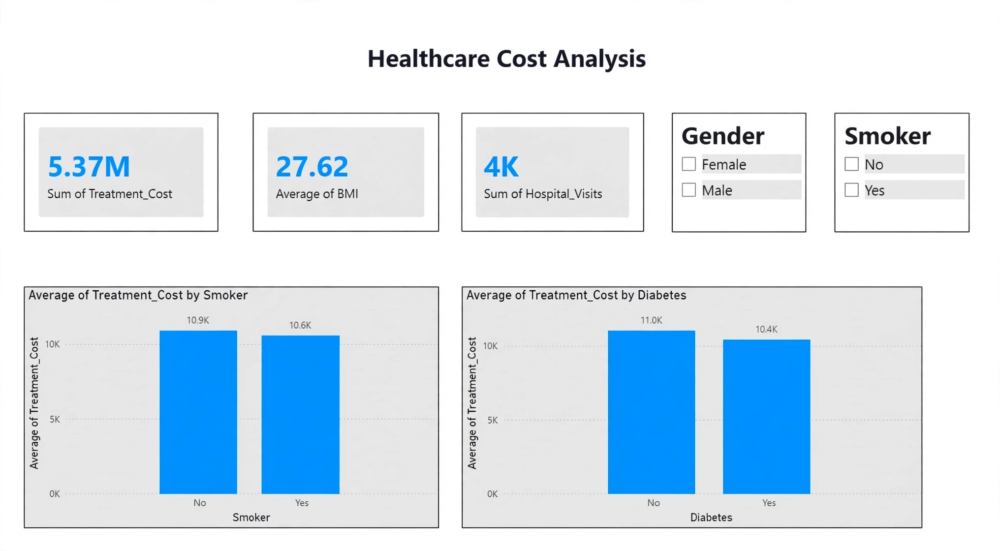
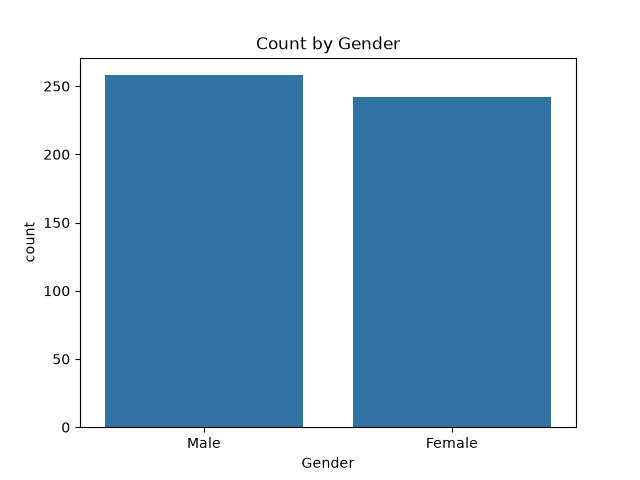
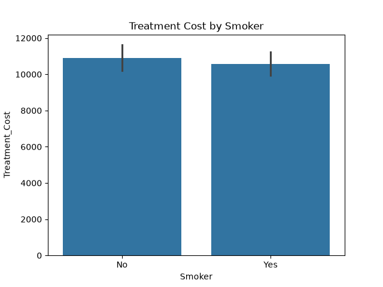

# Healthcare Cost Analysis | End-to-End Data Analytics Project

### 📊 Live Project Link: `github.com/pooja176/Healthcare-Project-Final`

### Project Overview
This project analyzes healthcare treatment costs based on patient age, gender, smoking, diabetes & region. Complete workflow from Excel -> SQL -> Python -> Power BI.

### 🛠️ Tools & Technologies
- **Excel:** Data Cleaning
- **MySQL:** Data Analysis (Joins, Aggregations)
- **Python:** Pandas, Matplotlib for EDA
- **Power BI:** Interactive Dashboard

### 📈 Key Insights
- **Total Treatment Cost:** ₹ 5.37M
- **Average BMI:** 27.62
- **Highest Cost Group:** Smokers (Avg ₹ 11.0K) & Diabetic Patients
- **Region:** Southeast has highest cost

### 📸 Power BI Dashboard

### Other Analysis
| Gender Count | Smoker vs Cost |
|---|---|
|  |  |

### 📁 Files in Repo
- `Healthcare_Dashboard.pbix` - Power BI file
- `healthcare_analysis_final.sql` - SQL Queries
- `Healthcare_Connector.py` - Python Code
- `healthcare_data.csv` - Dataset

**Created by: Pooja | Aspiring Data Analyst**
